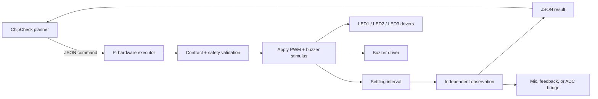

# Architecture

The Pi executor is a boundary component. It owns hardware timing, reset, range validation, and measurement quality. The planner owns search strategy, duplicate avoidance, budget allocation, and failure-region inference.

